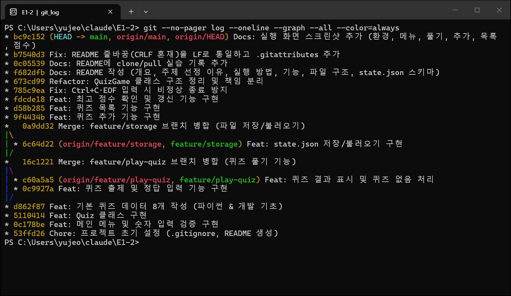
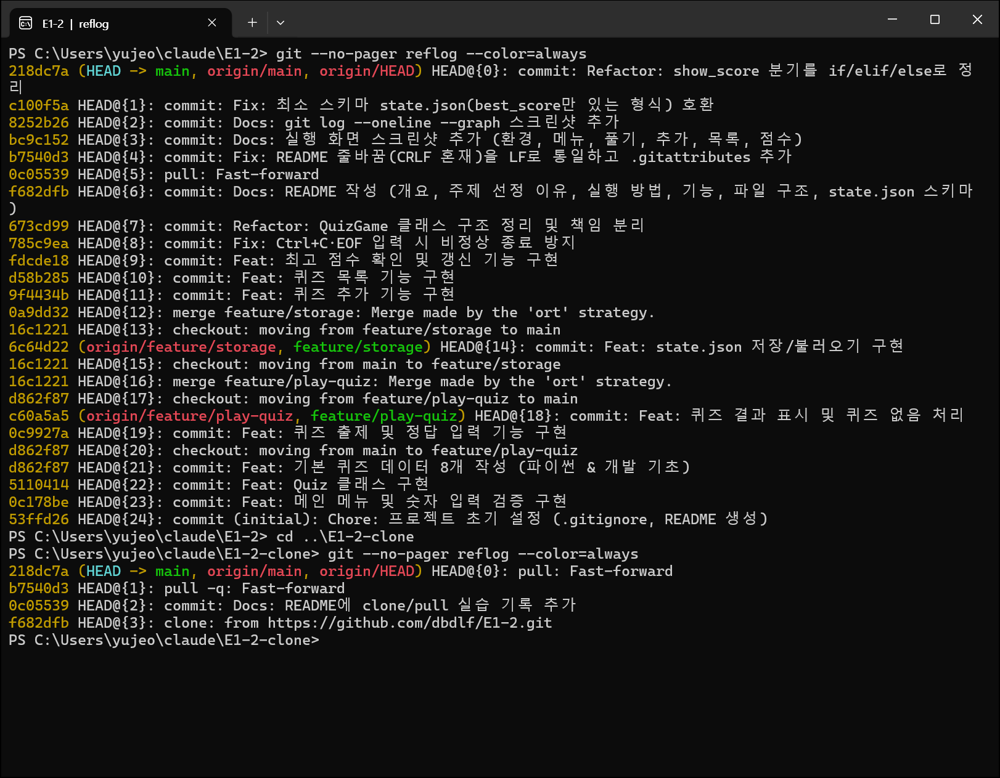

# 🎯 나만의 퀴즈 게임 (E1-2)

터미널에서 동작하는 **Python 콘솔 퀴즈 게임**입니다.
메뉴에서 번호를 골라 퀴즈를 풀고, 새 퀴즈를 등록하고, 목록과 최고 점수를 확인할 수 있습니다.
추가한 퀴즈와 최고 점수는 `state.json` 파일에 저장되어 프로그램을 껐다 켜도 그대로 유지됩니다.

---

## 목차

1. [프로젝트 개요](#1-프로젝트-개요)
2. [퀴즈 주제와 선정 이유](#2-퀴즈-주제와-선정-이유)
3. [실행 방법](#3-실행-방법)
4. [기능 목록](#4-기능-목록)
5. [파일 구조](#5-파일-구조)
6. [데이터 파일 설명 (state.json)](#6-데이터-파일-설명-statejson)
7. [실행 화면](#7-실행-화면)
8. [코드로 정리한 Python 핵심 개념](#8-코드로-정리한-python-핵심-개념)
9. [Git으로 이력 관리하기](#9-git으로-이력-관리하기)
10. [clone / pull 실습 기록](#10-clone--pull-실습-기록)
11. [요구사항 충족 체크리스트](#11-요구사항-충족-체크리스트)

---

## 1. 프로젝트 개요

| 항목 | 내용 |
| --- | --- |
| 목표 | Python 기본 문법 + 클래스 + 파일 입출력 + Git 워크플로우를 하나의 완성된 프로그램으로 경험 |
| 형태 | 표준 입력/출력 기반 콘솔 프로그램 |
| 언어 | Python 3.10 이상 (외부 라이브러리 없음, 표준 라이브러리 `json`, `os`, `pathlib`, `sys`만 사용) |
| 핵심 구조 | `Quiz`(문제 1개) · `QuizGame`(게임 진행) · `StateStorage`(파일 저장) 3개 클래스로 역할 분리 |
| 데이터 영속성 | 프로젝트 루트의 `state.json` (UTF-8 JSON) |

## 2. 퀴즈 주제와 선정 이유

**주제: 파이썬 & 개발 기초 상식** (자료형, 반복문, 클래스, Git, JSON 등)

- 이번 입학연수에서 처음 배우는 Python과 Git의 핵심 개념을 **직접 문제로 만들면서 복습**하기 위해 선택했습니다.
- 문제를 만들려면 정답뿐 아니라 "그럴듯한 오답"까지 고민해야 해서, 개념을 정확히 이해했는지 스스로 점검할 수 있습니다.
- 같은 과정을 밟는 동기들이 풀어 보며 함께 복습할 수 있는 실용적인 주제입니다.

기본 퀴즈 8문제가 `default_quizzes.py`에 들어 있으며, 메뉴에서 얼마든지 추가할 수 있습니다.

## 3. 실행 방법

```bash
# 1) 저장소 복제
git clone https://github.com/dbdlf/E1-2.git
cd E1-2

# 2) Python 버전 확인 (3.10 이상)
python --version

# 3) 실행
python main.py
```

- 별도 설치가 필요 없습니다. (`pip install` 불필요)
- 처음 실행하면 기본 퀴즈로 시작하고 `state.json`이 자동으로 만들어집니다.
- 종료: 메뉴에서 `5` 선택. `Ctrl+C`나 입력 종료(Windows `Ctrl+Z` 후 Enter / macOS·Linux `Ctrl+D`)를 눌러도 데이터를 저장하고 안전하게 종료됩니다.

## 4. 기능 목록

| 메뉴 | 기능 | 설명 |
| --- | --- | --- |
| 1 | 퀴즈 풀기 | 저장된 모든 퀴즈를 순서대로 출제 → 정답/오답 즉시 안내(오답이면 정답 공개) → 마지막에 `N문제 중 M문제 정답 (점수)` 표시. 최고 점수를 넘으면 갱신 후 저장. 퀴즈가 없으면 안내 |
| 2 | 퀴즈 추가 | 문제, 선택지 4개, 정답 번호(1~4)를 입력받아 등록하고 즉시 `state.json`에 저장 |
| 3 | 퀴즈 목록 | 등록된 퀴즈 개수와 문제 목록 출력. 퀴즈가 없으면 안내 |
| 4 | 점수 확인 | 최고 점수와 그때의 정답 수 출력. 아직 풀지 않았으면 안내 |
| 5 | 종료 | 데이터를 저장하고 종료 |

점수는 100점 만점으로 환산합니다. (`round(정답 수 / 문제 수 × 100)`, 예: 8문제 중 7문제 → 88점)

### 입력 / 예외 처리

| 상황 | 처리 |
| --- | --- |
| 입력 앞뒤 공백 (예: `  1  `) | 공백을 제거한 뒤 처리 |
| 숫자가 아닌 입력 (예: `abc`) | `⚠️ 잘못된 입력입니다. 1-5 사이의 숫자를 입력하세요.` 후 재입력 |
| 범위 밖 숫자 (예: 메뉴 `9`, 정답 `0`) | `⚠️ 범위를 벗어난 숫자입니다. ...` 후 재입력 |
| 빈 입력 (그냥 Enter) | `⚠️ 입력이 비어 있습니다. ...` 후 재입력 |
| 퀴즈 추가 시 빈 문제/선택지, 중복 선택지 | 안내 후 해당 항목만 재입력 |
| `Ctrl+C` (KeyboardInterrupt) / 입력 스트림 종료 (EOFError) | 안내 메시지 출력 → 저장 → 정상 종료 (Traceback 없음) |
| `state.json` 없음 (첫 실행) | 기본 퀴즈 8개로 시작하고 파일 생성 |
| `state.json` 손상 (JSON 문법 오류, 형식 오류, 인코딩 오류) | 안내 → 손상 파일을 `state.json.bak`으로 백업 → 기본 퀴즈로 복구 |
| 파일 읽기/쓰기 실패 (권한 등 `OSError`) | 안내 메시지 출력 후 프로그램은 계속 실행 |

## 5. 파일 구조

```
E1-2/
├── main.py              # 실행 진입점: 콘솔 UTF-8 설정, state.json 경로 지정, 게임 실행
├── quiz.py              # Quiz 클래스: 문제/선택지/정답, 출력·정답 확인·dict 변환
├── quiz_game.py         # QuizGame 클래스: 메뉴, 풀기, 추가, 목록, 점수, 저장/불러오기 흐름
├── storage.py           # StateStorage 클래스: state.json 읽기/쓰기, 스키마 검사, 백업
├── input_utils.py       # read_int / read_text: 공통 입력 검증 함수
├── default_quizzes.py   # 기본 퀴즈 8개 (Quiz 인스턴스로 생성)
├── docs/
│   └── screenshots/     # 실행 화면, 개발 환경, git log 스크린샷
├── README.md
├── .gitignore           # 캐시, 가상환경, state.json 등 추적 제외
├── .gitattributes       # 줄바꿈을 LF로 통일 (OS 간 불필요한 diff 방지)
└── state.json           # 실행 시 자동 생성되는 데이터 파일 (Git 추적 제외)
```

### 클래스 역할

| 클래스 | 속성 | 주요 메서드 |
| --- | --- | --- |
| `Quiz` | `question`, `choices`(4개), `answer`(1~4) | `display()`, `is_correct()`, `correct_choice()`, `to_dict()`, `from_dict()` |
| `QuizGame` | `quizzes`, `best_score`, `best_correct`, `best_total`, `storage`, `menu`, `running` | `run()`, `show_menu()`, `play_quiz()`, `add_quiz()`, `list_quizzes()`, `show_score()`, `load_state()`, `save_state()` |
| `StateStorage` | `path` | `load()`, `save()`, `backup_corrupted()` |

```
main.py ──▶ QuizGame ──┬──▶ Quiz (문제 출력 · 정답 확인)
                        ├──▶ StateStorage ──▶ state.json
                        └──▶ input_utils (read_int · read_text)
```

## 6. 데이터 파일 설명 (`state.json`)

- **경로**: 프로젝트 루트(`main.py`와 같은 폴더)의 `state.json`. 어느 폴더에서 실행해도 같은 파일을 사용합니다.
- **역할**: 퀴즈 목록과 최고 점수를 저장해 프로그램을 다시 실행해도 데이터가 유지되게 합니다.
- **인코딩**: UTF-8 (한글이 그대로 보이도록 `ensure_ascii=False`로 저장, BOM이 붙은 UTF-8도 읽기 가능)
- **저장 시점**: 첫 실행 시, 퀴즈 추가 직후, 최고 점수 갱신 직후, 프로그램 종료 시
- **안전한 저장**: `state.json.tmp`에 먼저 쓴 뒤 원래 파일과 교체하여, 저장 중 중단되어도 기존 파일이 깨지지 않습니다.
- **Git 추적 제외**: 실행할 때마다 내용이 바뀌는 개인 데이터이므로 `.gitignore`에 등록했습니다.

### 스키마

| 키 | 타입 | 필수 | 설명 |
| --- | --- | --- | --- |
| `quizzes` | 배열 | ✅ | 퀴즈 목록 (빈 배열이면 "퀴즈 없음" 상태) |
| `quizzes[].question` | 문자열 | ✅ | 문제 |
| `quizzes[].choices` | 문자열 배열 (4개) | ✅ | 선택지 1~4 |
| `quizzes[].answer` | 정수 (1~4) | ✅ | 정답 선택지 번호 |
| `best_score` | 정수 (0~100) 또는 `null` | | 최고 점수 (100점 만점). 아직 풀지 않았으면 `null` |
| `best_correct` | 정수 또는 `null` | | 최고 점수를 기록했을 때 맞힌 문제 수 |
| `best_total` | 정수 또는 `null` | | 최고 점수를 기록했을 때 푼 문제 수 |

`{"quizzes": [...], "best_score": 3}` 처럼 최소 형식으로 작성한 파일도 그대로 읽을 수 있습니다.

### 예시

```json
{
    "quizzes": [
        {
            "question": "파이썬에서 리스트의 길이(원소 개수)를 구하는 내장 함수는?",
            "choices": ["len()", "size()", "length()", "count()"],
            "answer": 1
        }
    ],
    "best_score": 88,
    "best_correct": 7,
    "best_total": 8
}
```

## 7. 실행 화면

Windows Terminal에서 `python main.py`를 실행한 실제 화면입니다. (`docs/screenshots/`)

### 개발 환경 (Python / Git / VS Code 버전, Git 설정)


### 메뉴 & 잘못된 입력 처리 (첫 실행: `state.json` 없음 → 기본 퀴즈 8개)


### 퀴즈 풀기 (정답/오답 안내 → 결과 → 최고 점수 갱신)


### 퀴즈 추가 (중복 선택지, 범위 밖 정답 번호 재입력)


### 퀴즈 목록 (프로그램 재실행 후에도 추가한 9번 퀴즈 유지)


### 점수 확인 (재실행 후 최고 점수 유지)


---

## 8. 코드로 정리한 Python 핵심 개념

이 프로젝트를 만들면서 사용한 개념을, 실제 코드가 어디서 왜 그렇게 쓰였는지와 함께 정리했습니다.

### 8-1. 변수

변수는 **값에 이름을 붙여 두는 것**입니다. 이름이 있으면 같은 값을 여러 곳에서 다시 쓸 수 있고, 값이 바뀌어도 코드가 무엇을 뜻하는지 읽힙니다.

```python
correct = 0                 # 지금까지 맞힌 문제 수
for number, quiz in enumerate(self.quizzes, start=1):
    if self.ask_question(number, quiz):
        correct += 1        # 값은 계속 바뀌지만 이름이 의미를 설명한다
```

`LINE = "=" * 40` 처럼 여러 화면에서 쓰는 구분선을 변수 하나로 두면, 모양을 바꿀 때 한 곳만 고치면 됩니다.

### 8-2. 자료형: `int`, `str`, `bool`, `list`, `dict`

| 자료형 | 의미 | 이 프로젝트에서 | 특징 |
| --- | --- | --- | --- |
| `int` | 정수 | `answer = 2`, `best_score = 88` | 사칙연산, 크기 비교 가능 |
| `str` | 문자열 | `question`, `input()`의 결과 | `input()`은 **항상 `str`을 돌려주므로** 숫자로 쓰려면 `int()`로 변환해야 함 → `read_int` |
| `bool` | 참/거짓 (`True`/`False`) | `self.running`, `is_correct()`의 반환값 | 조건문과 반복 제어에 사용 |
| `list` | 순서가 있는 값의 모음, 수정 가능 | `self.quizzes`, `choices` | 인덱스(`choices[0]`), `append()`, `for` 반복 |
| `dict` | 키 → 값 쌍의 모음 | `quiz.to_dict()`, `self.menu`, `state.json` 최상위 | 이름(키)으로 값을 찾음, JSON 객체와 1:1 대응 |

주의할 점: `bool`은 `int`의 하위 타입이라 `isinstance(True, int)`가 `True`입니다.
그래서 `Quiz`는 정답 번호를 검사할 때 `isinstance(answer, bool)`을 따로 막아 `"answer": true` 같은 잘못된 데이터를 거릅니다.

### 8-3. 조건문 `if / elif / else`

조건에 따라 서로 다른 동작을 실행합니다. 위에서부터 차례로 검사해 처음 참인 블록 하나만 실행됩니다.

```python
# quiz_game.py - show_score()
if self.best_score is None:          # 아직 한 번도 풀지 않음
    print("🏆 아직 퀴즈를 푼 기록이 없습니다.")
elif self.best_total is None:        # 점수만 저장된 최소 형식
    ...
else:                                # 정답 수까지 있는 일반적인 경우
    print(f"🏆 최고 점수: {self.best_score}점 ({self.best_total}문제 중 {self.best_correct}문제 정답)")
```

메뉴 분기도 처음에는 `if choice == 1: ... elif choice == 2: ... else:` 로 작성했다가(커밋 `0c178be`),
메뉴가 늘어나도 한 줄만 추가하면 되도록 **번호 → 메서드 딕셔너리**로 리팩터링했습니다(커밋 `673cd99`).

### 8-4. `for` vs `while`

| | `for` | `while` |
| --- | --- | --- |
| 언제 쓰나 | 반복할 **대상이나 횟수가 정해져** 있을 때 | **조건이 만족될 때까지**, 몇 번 반복할지 모를 때 |
| 이 프로젝트 | 퀴즈 목록을 처음부터 끝까지 출제 | 올바른 값이 들어올 때까지 재입력, 종료를 고를 때까지 메뉴 반복 |

```python
for number, quiz in enumerate(self.quizzes, start=1):   # 퀴즈 개수만큼 정확히 반복
    ...

while True:                                             # 올바른 숫자가 들어올 때까지 반복
    raw = input(prompt).strip()
    ...
    return value                                        # 조건을 만족하면 빠져나감
```

선택지 4개 입력(`read_choices`)은 "4번"처럼 보이지만, 중복 선택지를 다시 받아야 해서 실제 반복 횟수가 정해져 있지 않습니다.
그래서 `for`가 아니라 `while len(choices) < 4:` 를 사용했습니다.

### 8-5. 함수: 매개변수와 반환값

함수는 **반복되는 작업에 이름을 붙여 재사용**하는 방법입니다. 매개변수로 필요한 값을 받고, `return`으로 결과를 돌려줍니다.

```python
def read_int(prompt: str, min_value: int, max_value: int) -> int:
    """min_value~max_value 범위의 정수를 입력받을 때까지 반복한다."""
    ...
    return value
```

- 메뉴 선택 `read_int("선택: ", 1, 5)`, 정답 입력 `read_int("정답 입력: ", 1, 4)`가 **같은 함수를 매개변수만 바꿔** 사용합니다.
  입력 검증 규칙이 한 곳에만 있으므로 고칠 때도 한 곳만 고치면 됩니다.
- `calculate_score(correct, total)`는 값을 출력하지 않고 **반환**만 합니다. 덕분에 결과 출력, 최고 점수 비교 등 여러 곳에서 그 값을 다시 쓸 수 있습니다.

### 8-6. 클래스와 객체

**클래스**는 데이터(속성)와 그 데이터를 다루는 기능(메서드)을 하나로 묶은 **설계도**이고, **객체(인스턴스)**는 그 설계도로 만든 실체입니다.

왜 클래스를 썼나?
- 퀴즈 8개를 딕셔너리 8개로 다루면 "선택지가 4개인지", "정답 번호가 1~4인지" 검사하는 코드가 여기저기 흩어집니다.
  `Quiz` 클래스는 생성 시점에 검사하므로 **잘못된 퀴즈 객체는 아예 만들어지지 않습니다.**
- 역할별로 클래스를 나누면(`Quiz` / `QuizGame` / `StateStorage`) 저장 방식을 바꿔도 게임 로직은 건드리지 않아도 됩니다.

```python
class Quiz:
    def __init__(self, question, choices, answer):   # 객체가 만들어질 때 자동 호출
        ...                                           # (값 검사)
        self.question = question                      # 속성: 객체가 기억하는 데이터
        self.choices = choices
        self.answer = answer

    def is_correct(self, user_answer):                # 메서드: 객체가 할 수 있는 일
        return user_answer == self.answer


quiz = Quiz("1바이트는 몇 비트?", ["4", "8", "16", "32"], 2)   # 인스턴스 생성 → __init__ 실행
quiz.is_correct(2)                                              # True
```

- **`__init__`**: 객체를 만들 때(`Quiz(...)`) 자동으로 실행되는 초기화 메서드입니다. 속성의 처음 값을 정하고 검사합니다.
- **`self`**: 메서드를 호출한 **그 객체 자신**입니다. `quiz.is_correct(2)`는 내부적으로 `Quiz.is_correct(quiz, 2)`로 실행되므로,
  `self.answer`는 "이 퀴즈의 정답"을 뜻합니다. 퀴즈가 여러 개여도 각자 자기 정답을 기억하는 이유입니다.
- **속성 / 메서드**: `self.question`처럼 객체에 저장된 값이 속성, `display()`·`is_correct()`처럼 객체에 정의된 함수가 메서드입니다.
- 이 밖에 객체 없이 클래스 자체로 객체를 만드는 `@classmethod Quiz.from_dict()`,
  `self`가 필요 없는 계산용 `@staticmethod QuizGame.calculate_score()`도 사용했습니다.

### 8-7. 파일 입출력

파일 처리는 **열기 → 읽기/쓰기 → 닫기** 순서입니다. `with` 문을 쓰면 블록이 끝날 때(오류가 나도) 파일이 자동으로 닫힙니다.

```python
# 쓰기 (storage.py - save)
with open(temp_path, "w", encoding="utf-8") as file:     # "w": 쓰기 모드(덮어쓰기)
    json.dump(data, file, ensure_ascii=False, indent=4)

# 읽기 (storage.py - load)
with open(self.path, "r", encoding="utf-8-sig") as file: # "r": 읽기 모드
    data = json.load(file)
```

`encoding`을 꼭 지정한 이유: Windows의 기본 인코딩은 `cp949`라서, 지정하지 않으면 다른 환경에서 저장한 한글이 깨지거나 오류가 납니다.

### 8-8. JSON

JSON(JavaScript Object Notation)은 **텍스트로 된 데이터 표현 형식**입니다.

- 사람이 메모장으로 열어 읽고 고칠 수 있습니다.
- Python 기본 라이브러리 `json`만으로 저장(`json.dump`)·불러오기(`json.load`)가 됩니다.
- 언어에 상관없이 쓰이는 표준이라 다른 프로그램과 데이터를 주고받기 쉽습니다.

| Python | JSON |
| --- | --- |
| `dict` | 객체 `{ }` |
| `list` | 배열 `[ ]` |
| `str` | 문자열 `"..."` |
| `int` | 숫자 |
| `True` / `False` | `true` / `false` |
| `None` | `null` |

JSON에는 "Quiz 객체"라는 개념이 없으므로, 저장할 때는 `quiz.to_dict()`로 딕셔너리로 바꾸고, 불러올 때는 `Quiz.from_dict()`로 다시 객체로 만듭니다.

### 8-9. 예외 처리 `try / except`

오류가 날 수 있는 코드를 `try`에 넣고, 오류가 나면 `except`에서 처리해 **프로그램이 멈추지 않게** 합니다.

```python
try:
    value = int(raw)            # "abc"면 ValueError 발생
except ValueError:
    print("⚠️ 잘못된 입력입니다. 1-5 사이의 숫자를 입력하세요.")
    continue                    # 프로그램을 끝내지 않고 다시 입력받기
```

| 예외 | 언제 발생 | 처리 |
| --- | --- | --- |
| `ValueError` | `int("abc")` | 안내 후 재입력 |
| `FileNotFoundError` | `state.json`이 없음 (첫 실행) | 기본 퀴즈로 시작 |
| `json.JSONDecodeError`, `UnicodeDecodeError` | 파일 내용이 깨짐 | 직접 만든 `StateFileError`로 묶어 "손상"으로 처리 → 백업 후 복구 |
| `OSError` | 권한 문제 등 읽기/쓰기 실패 | 안내 후 계속 실행 |
| `KeyboardInterrupt`, `EOFError` | `Ctrl+C`, 입력 스트림 종료 | 저장 후 안전하게 종료 |

`FileNotFoundError`는 `OSError`의 하위 클래스이므로, `except FileNotFoundError`를 `except OSError`보다 **먼저** 써야 "파일 없음"을 따로 처리할 수 있습니다.

---

## 9. Git으로 이력 관리하기

### 9-1. Git이란, 왜 필요한가

Git은 파일의 변경 이력을 기록하는 **분산 버전 관리 시스템**입니다.

- **기록**: 언제, 무엇을, 왜 바꿨는지 커밋 단위로 남습니다. (`git log`)
- **되돌리기**: 잘못 바꿨을 때 이전 상태로 돌아갈 수 있습니다.
- **안전한 실험**: 브랜치에서 새 기능을 만들고, 완성되면 `main`에 합칩니다. 실패해도 `main`은 그대로입니다.
- **협업 / 백업**: GitHub 같은 원격 저장소로 코드를 공유하고, 다른 컴퓨터에서도 그대로 받아 이어서 작업할 수 있습니다.

```
작업 디렉터리 ──git add──▶ 스테이징 영역 ──git commit──▶ 로컬 저장소 ──git push──▶ 원격 저장소(GitHub)
      ▲                                                                              │
      └───────────────────────────── git pull / git clone ───────────────────────────┘
```

### 9-2. 기본 명령어 7종과 이 프로젝트에서의 사용

| 명령어 | 하는 일 | 이 프로젝트에서 실제로 사용한 예 |
| --- | --- | --- |
| `git init` | 현재 폴더를 Git 저장소로 만든다 (`.git` 폴더 생성) | `git init -b main` |
| `git add` | 변경한 파일을 다음 커밋에 넣도록 스테이징한다 | `git add quiz.py` |
| `git commit` | 스테이징된 변경을 하나의 이력(스냅샷)으로 저장한다 | `git commit -m "Feat: Quiz 클래스 구현"` |
| `git push` | 로컬 커밋을 원격 저장소에 올린다 | `git push -u origin main` |
| `git pull` | 원격의 새 커밋을 가져와 현재 브랜치에 합친다 (`fetch` + `merge`) | 기존 폴더 `E1-2`에서 `git pull` |
| `git checkout` | 브랜치를 바꾸거나(`-b`로) 새로 만든다 | `git checkout -b feature/play-quiz`, `git checkout main` |
| `git clone` | 원격 저장소 전체(이력 포함)를 새 폴더에 복제한다 | `git clone https://github.com/dbdlf/E1-2.git E1-2-clone` |

### 9-3. 커밋 규칙

기능 단위로 커밋하고, 메시지 앞에 작업 종류를 붙였습니다.

| 접두어 | 의미 | 예 |
| --- | --- | --- |
| `Feat:` | 기능 추가 | `Feat: 퀴즈 추가 기능 구현` |
| `Fix:` | 버그 수정 | `Fix: Ctrl+C·EOF 입력 시 비정상 종료 방지` |
| `Refactor:` | 동작은 같고 구조만 개선 | `Refactor: QuizGame 클래스 구조 정리 및 책임 분리` |
| `Docs:` | 문서 | `Docs: README 작성` |
| `Chore:` | 설정 등 기타 | `Chore: 프로젝트 초기 설정` |

### 9-4. 브랜치 생성과 병합

큰 기능은 `main`이 아닌 별도 브랜치에서 개발한 뒤 병합했습니다.

```bash
git checkout -b feature/play-quiz      # 새 브랜치를 만들고 이동
# ... 퀴즈 풀기 기능 작업, 커밋 2개 ...
git checkout main                      # main으로 돌아옴
git merge --no-ff feature/play-quiz    # 병합 (--no-ff: 병합 커밋을 남겨 그래프에 브랜치 흔적이 보이게)
```

| 브랜치 | 작업 내용 | 병합 커밋 |
| --- | --- | --- |
| `feature/play-quiz` | 퀴즈 출제, 정답 확인, 결과 표시, 퀴즈 없음 처리 | `16c1221` |
| `feature/storage` | `state.json` 저장/불러오기, 손상 파일 복구 | `0a9dd32` |



## 10. clone / pull 실습 기록

1. `git clone https://github.com/dbdlf/E1-2.git E1-2-clone` 으로 별도 디렉터리에 저장소를 복제했습니다.
2. 복제본(`E1-2-clone`)에서 README에 실습 기록 섹션을 추가해 `commit` → `push` 했습니다. (커밋 `0c05539`)
3. 기존 작업 디렉터리(`E1-2`)에서 `git pull` 로 이 변경 사항을 가져와(Fast-forward) README에 반영된 것을 확인했습니다.
4. 이후 기존 디렉터리에서 올린 수정도 복제본에서 다시 `git pull` 로 받아 두 폴더를 같은 상태로 맞췄습니다.

아래는 두 폴더의 `git reflog`입니다. `clone`, `pull`, `checkout`, `merge`, `commit` 기록을 확인할 수 있습니다.



## 11. 요구사항 충족 체크리스트

| 요구사항 | 충족 내용 |
| --- | --- |
| 메뉴 / 종료 / 잘못된 입력 처리 | `QuizGame.run`, `show_menu`, `read_int` (공백 제거·문자·범위 밖·빈 입력) |
| Ctrl+C / EOF 안전 종료 | `QuizGame.handle_interrupt` (저장 후 종료) |
| `Quiz` 클래스 (문제, 선택지 4개, 정답 1~4, 출력·정답 확인) | `quiz.py` |
| 기본 퀴즈 5개 이상 (Quiz 인스턴스) | `default_quizzes.py` (8개) |
| 퀴즈 풀기 (출제, 입력, 정답/오답, 결과, 퀴즈 없음) | `play_quiz`, `ask_question`, `show_result` (`feature/play-quiz` 브랜치) |
| 퀴즈 추가 (입력 검증, 파일 저장) | `add_quiz`, `read_choices` |
| 퀴즈 목록 (퀴즈 없음 처리) | `list_quizzes` |
| 점수 확인 (최고 점수 비교·갱신·저장, 기록 없음 처리) | `show_score`, `update_best_score` |
| `QuizGame` 클래스 (퀴즈 목록·최고 점수, 기능별 메서드) | `quiz_game.py` |
| `state.json` 저장/불러오기 (UTF-8, 없음/손상 처리, try/except) | `storage.py`, `load_state`, `save_state` |
| 클래스 2개 이상 | `Quiz`, `QuizGame`, `StateStorage` (3개) |
| 의미 있는 커밋 10개 이상 | 병합 커밋 제외 21개 (`Feat`/`Fix`/`Refactor`/`Docs`/`Chore` 접두어 + 변경 요약) |
| 브랜치 생성 및 병합 | `feature/play-quiz`, `feature/storage` → `main` |
| Git 명령어 7종 | 9-2 표, 10번 reflog 스크린샷 참고 |
| `.gitignore`, `README.md` | 저장소 루트 |
| Python 3.10+, 외부 라이브러리 없음 | 표준 라이브러리만 사용 |
| 제출 스크린샷 (환경, 추가, 목록, 플레이, 점수, git log) | `docs/screenshots/` |
