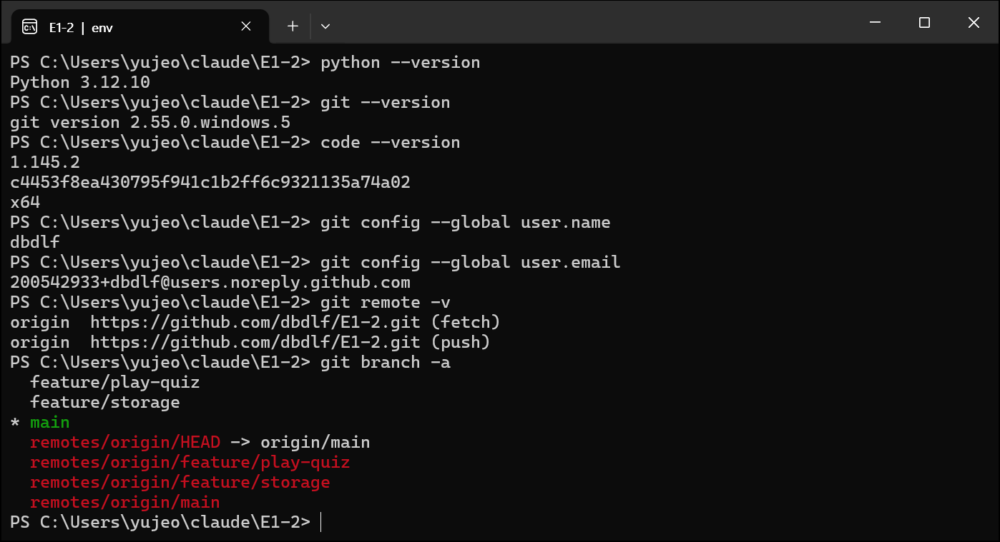
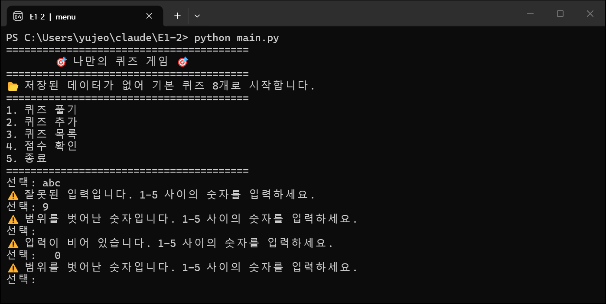
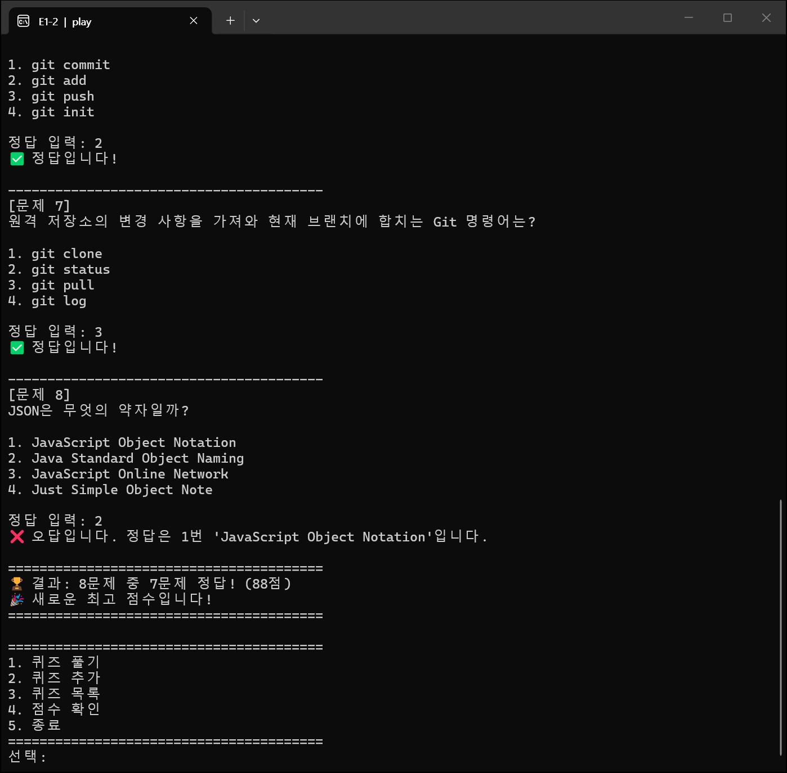
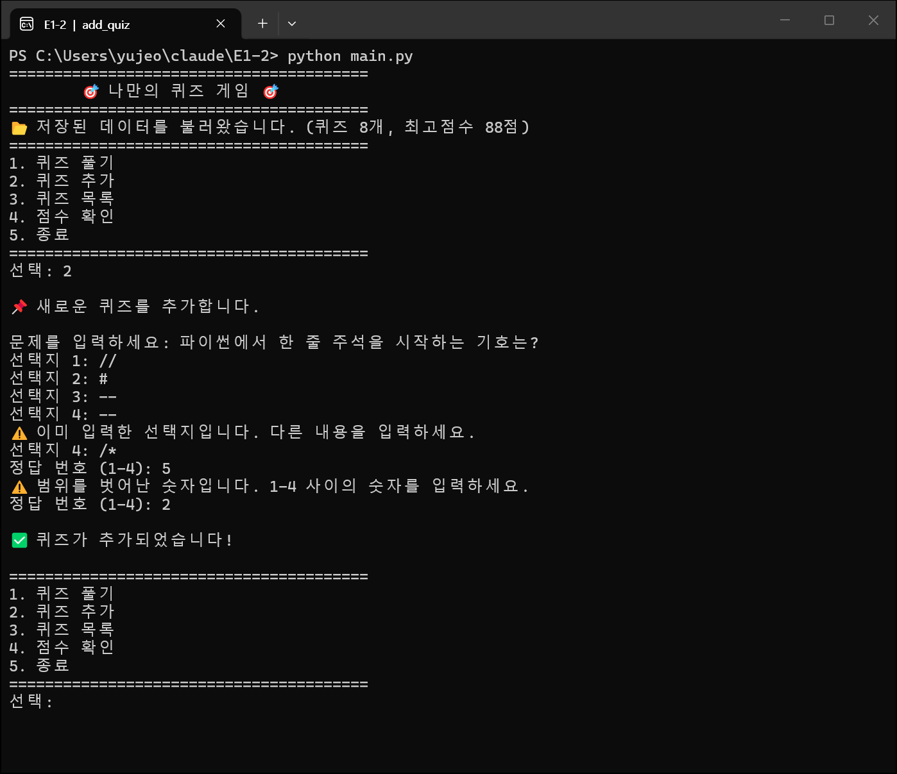
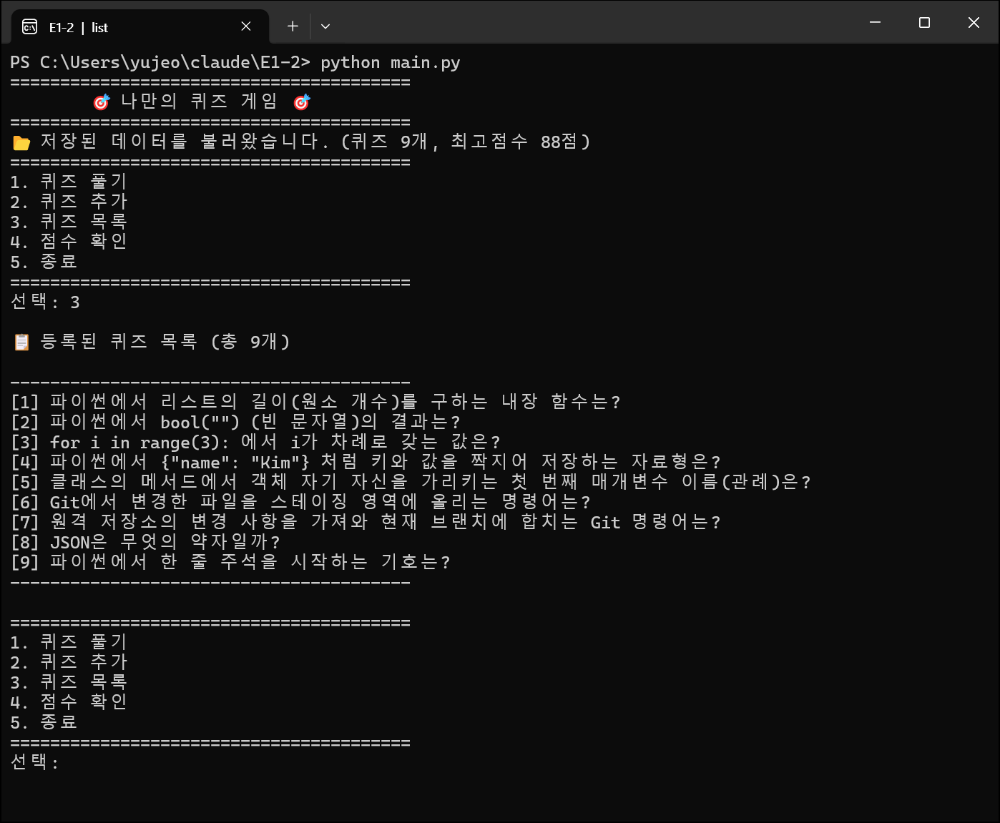
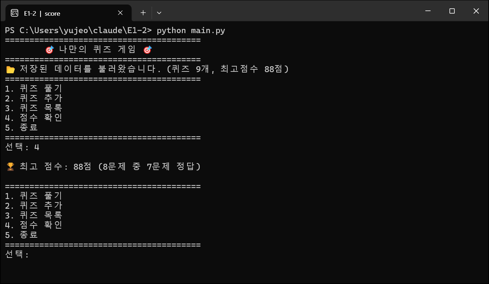

# 🎯 나만의 퀴즈 게임 (E1-2)

터미널에서 동작하는 **Python 콘솔 퀴즈 게임**입니다.
메뉴에서 번호를 골라 퀴즈를 풀고, 새 퀴즈를 등록하고, 목록과 최고 점수를 확인할 수 있습니다.
추가한 퀴즈와 최고 점수는 `state.json` 파일에 저장되어 프로그램을 껐다 켜도 그대로 유지됩니다.

---

## 1. 프로젝트 개요

| 항목 | 내용 |
| --- | --- |
| 목표 | Python 기본 문법 + 클래스 + 파일 입출력 + Git 워크플로우를 하나의 완성된 프로그램으로 경험 |
| 형태 | 표준 입력/출력 기반 콘솔 프로그램 |
| 언어 | Python 3.10 이상 (외부 라이브러리 없음, 표준 라이브러리만 사용) |
| 핵심 구조 | `Quiz`(문제 1개) · `QuizGame`(게임 진행) · `StateStorage`(파일 저장) 3개 클래스로 역할 분리 |
| 데이터 영속성 | 프로젝트 루트의 `state.json` (UTF-8 JSON) |

## 2. 퀴즈 주제와 선정 이유

**주제: 파이썬 & 개발 기초 상식** (자료형, 반복문, 클래스, Git, JSON 등)

- 이번 입학연수에서 처음 배우는 Python과 Git의 핵심 개념을 **직접 문제로 만들면서 복습**하기 위해 선택했습니다.
- 문제를 만들려면 정답뿐 아니라 "그럴듯한 오답"까지 고민해야 해서, 개념을 정확히 이해했는지 스스로 점검할 수 있습니다.
- 같은 과정을 밟는 동기들이 풀어 보며 함께 복습할 수 있는 실용적인 주제입니다.

기본 퀴즈 8문제가 `default_quizzes.py`에 들어 있으며, 메뉴에서 얼마든지 추가할 수 있습니다.

## 3. 실행 방법

```bash
# 1) 저장소 복제
git clone https://github.com/dbdlf/E1-2.git
cd E1-2

# 2) Python 버전 확인 (3.10 이상)
python --version

# 3) 실행
python main.py
```

- 별도 설치가 필요 없습니다. (`pip install` 불필요)
- 처음 실행하면 기본 퀴즈로 시작하고 `state.json`이 자동으로 만들어집니다.
- 종료: 메뉴에서 `5` 선택. `Ctrl+C`나 입력 종료(`Ctrl+Z`/`Ctrl+D`)를 눌러도 데이터를 저장하고 안전하게 종료됩니다.

## 4. 기능 목록

| 메뉴 | 기능 | 설명 |
| --- | --- | --- |
| 1 | 퀴즈 풀기 | 저장된 모든 퀴즈를 순서대로 출제 → 정답/오답 즉시 안내(오답이면 정답 공개) → 마지막에 `N문제 중 M문제 정답 (점수)` 표시. 최고 점수를 넘으면 갱신 후 저장. 퀴즈가 없으면 안내 |
| 2 | 퀴즈 추가 | 문제, 선택지 4개, 정답 번호(1~4)를 입력받아 등록하고 즉시 `state.json`에 저장 |
| 3 | 퀴즈 목록 | 등록된 퀴즈 개수와 문제 목록 출력. 퀴즈가 없으면 안내 |
| 4 | 점수 확인 | 최고 점수와 그때의 정답 수 출력. 아직 풀지 않았으면 안내 |
| 5 | 종료 | 데이터를 저장하고 종료 |

### 입력 / 예외 처리

| 상황 | 처리 |
| --- | --- |
| 입력 앞뒤 공백 (예: `  1  `) | 공백을 제거한 뒤 처리 |
| 숫자가 아닌 입력 (예: `abc`) | `⚠️ 잘못된 입력입니다. 1-5 사이의 숫자를 입력하세요.` 후 재입력 |
| 범위 밖 숫자 (예: 메뉴 `9`, 정답 `0`) | `⚠️ 범위를 벗어난 숫자입니다. ...` 후 재입력 |
| 빈 입력 (그냥 Enter) | `⚠️ 입력이 비어 있습니다. ...` 후 재입력 |
| 퀴즈 추가 시 빈 문제/선택지, 중복 선택지 | 안내 후 해당 항목만 재입력 |
| `Ctrl+C` (KeyboardInterrupt) / 입력 스트림 종료 (EOFError) | 안내 메시지 출력 → 저장 → 정상 종료 (Traceback 없음) |
| `state.json` 없음 (첫 실행) | 기본 퀴즈 8개로 시작하고 파일 생성 |
| `state.json` 손상 (JSON 문법 오류, 형식 오류, 인코딩 오류) | 안내 → 손상 파일을 `state.json.bak`으로 백업 → 기본 퀴즈로 복구 |
| 파일 읽기/쓰기 실패 (권한 등 `OSError`) | 안내 메시지 출력 후 프로그램은 계속 실행 |

## 5. 파일 구조

```
E1-2/
├── main.py              # 실행 진입점: 콘솔 UTF-8 설정, state.json 경로 지정, 게임 실행
├── quiz.py              # Quiz 클래스: 문제/선택지/정답, 출력·정답 확인·dict 변환
├── quiz_game.py         # QuizGame 클래스: 메뉴, 풀기, 추가, 목록, 점수, 저장/불러오기 흐름
├── storage.py           # StateStorage 클래스: state.json 읽기/쓰기, 스키마 검사, 백업
├── input_utils.py       # read_int / read_text: 공통 입력 검증 함수
├── default_quizzes.py   # 기본 퀴즈 8개 (Quiz 인스턴스로 생성)
├── README.md
├── .gitignore
└── state.json           # 실행 시 자동 생성되는 데이터 파일 (Git 추적 제외)
```

### 클래스 역할

| 클래스 | 속성 | 주요 메서드 |
| --- | --- | --- |
| `Quiz` | `question`, `choices`(4개), `answer`(1~4) | `display()`, `is_correct()`, `correct_choice()`, `to_dict()`, `from_dict()` |
| `QuizGame` | `quizzes`, `best_score`, `best_correct`, `best_total`, `storage`, `menu` | `run()`, `show_menu()`, `play_quiz()`, `add_quiz()`, `list_quizzes()`, `show_score()`, `load_state()`, `save_state()` |
| `StateStorage` | `path` | `load()`, `save()`, `backup_corrupted()` |

## 6. 데이터 파일 설명 (`state.json`)

- **경로**: 프로젝트 루트(`main.py`와 같은 폴더)의 `state.json`. 어느 폴더에서 실행해도 같은 파일을 사용합니다.
- **역할**: 퀴즈 목록과 최고 점수를 저장해 프로그램을 다시 실행해도 데이터가 유지되게 합니다.
- **인코딩**: UTF-8 (한글이 그대로 보이도록 `ensure_ascii=False`로 저장)
- **저장 시점**: 첫 실행 시, 퀴즈 추가 직후, 최고 점수 갱신 직후, 프로그램 종료 시
- **안전한 저장**: `state.json.tmp`에 먼저 쓴 뒤 원래 파일과 교체하여, 저장 중 중단되어도 기존 파일이 깨지지 않습니다.
- **Git 추적 제외**: 실행할 때마다 내용이 바뀌는 개인 데이터이므로 `.gitignore`에 등록했습니다.

### 스키마

| 키 | 타입 | 설명 |
| --- | --- | --- |
| `quizzes` | 배열 | 퀴즈 목록 |
| `quizzes[].question` | 문자열 | 문제 |
| `quizzes[].choices` | 문자열 배열 (4개) | 선택지 1~4 |
| `quizzes[].answer` | 정수 (1~4) | 정답 선택지 번호 |
| `best_score` | 정수 (0~100) 또는 `null` | 최고 점수 (100점 만점). 아직 풀지 않았으면 `null` |
| `best_correct` | 정수 또는 `null` | 최고 점수를 기록했을 때 맞힌 문제 수 |
| `best_total` | 정수 또는 `null` | 최고 점수를 기록했을 때 푼 문제 수 |

### 예시

```json
{
    "quizzes": [
        {
            "question": "파이썬에서 리스트의 길이(원소 개수)를 구하는 내장 함수는?",
            "choices": ["len()", "size()", "length()", "count()"],
            "answer": 1
        }
    ],
    "best_score": 75,
    "best_correct": 6,
    "best_total": 8
}
```

## 7. 실행 화면

Windows Terminal에서 `python main.py`를 실행한 실제 화면입니다. (`docs/screenshots/`)

### 개발 환경 (Python / Git / VS Code 버전, Git 설정)



### 메뉴 & 잘못된 입력 처리 (첫 실행: `state.json` 없음 → 기본 퀴즈 8개)



### 퀴즈 풀기 (정답/오답 안내 → 결과 → 최고 점수 갱신)



### 퀴즈 추가 (중복 선택지, 범위 밖 정답 번호 재입력)



### 퀴즈 목록 (프로그램 재실행 후에도 추가한 9번 퀴즈 유지)



### 점수 확인 (재실행 후 최고 점수 유지)



## 8. Git 작업 흐름

- 기능 단위 커밋: `Feat:` 기능 추가, `Fix:` 버그 수정, `Refactor:` 구조 개선, `Docs:` 문서, `Chore:` 설정
- 브랜치 전략: 큰 기능은 `feature/*` 브랜치에서 개발 후 `main`에 `--no-ff`로 병합
  - `feature/play-quiz` — 퀴즈 풀기 기능
  - `feature/storage` — `state.json` 저장/불러오기
- 커밋 그래프 확인: `git log --oneline --graph`

## 9. clone / pull 실습 기록

1. `git clone https://github.com/dbdlf/E1-2.git E1-2-clone` 으로 별도 디렉터리에 저장소를 복제했습니다.
2. 복제본(`E1-2-clone`)에서 이 섹션을 추가해 `commit` → `push` 했습니다.
3. 기존 작업 디렉터리(`E1-2`)에서 `git pull` 로 이 변경 사항을 가져와 반영을 확인했습니다.
